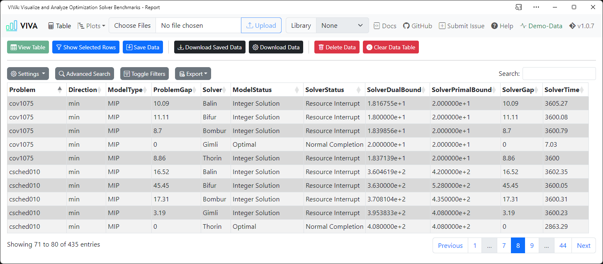

<h1 align="center">
  
</h1>

<p align="center">
<a href="https://github.com/Oscar-97/VIVA-Benchmark-Data-Analysis/releases">
    
</a>
<a href="https://github.com/Oscar-97/VIVA-Benchmark-Data-Analysis?tab=MIT-1-ov-file#readme">
    
</a>


</p>

Building on the concept and implementation of [PAVER 2.0](https://github.com/coin-or/paver), the main goal of VIVA is to allow end users to interact with their own uploaded benchmark data from mathematical optimization problems and their solvers. The data is presented in a tabular format, with the added ability to visualize specific results through various plots, making it easier to understand and interpret the data. 

Demo-data is attained from [miplib2010 examples](https://github.com/coin-or/Paver/tree/master/examples/miplib2010). The `.solu` file data from the problem libraries [MINLPLib](https://www.minlplib.org/minlplib.solu), [MIPLIB 2017](https://miplib.zib.de/downloads/miplib2017-v26.solu) and [MIPLIB 2010](https://miplib2010.zib.de/download/miplib2010_all.solu) can be used directly with the **Best-known bounds** selector in the navigation bar.

This project is developed using:
- TypeScript
- DataTables.js
- jQuery
- mathjs
- Chart.js
- Webpack
- Bootstrap & Bootstrap Icons

The application can be run without a live server since Webpack is responsible for bundling the files. It is also possible to install it as a Progressive Web Application by launching the project in a live server, navigating to the report page using a compatible browser, and installing it. Currently, this gives access to notifications when a table or graph has been successfully rendered with results. Support for offline functionality is also included in the PWA implementation. Additional PWA functionality will be added during development.

<div style="text-align:left;">
  
</div>

## Disclaimer
**Performance Note**:  Performance slowdowns may occur when handling a large number of files or particularly large datasets, as this application operates entirely in the browser without relying on a backend server to parse and process the files. 

**Display Note**: While mobile-sized screens are supported, the most optimal experience is achieved using a larger display. A light and a dark theme are available.

**Development Note**:  This project is still a work in progress, and therefore, bugs and unexpected behavior may occur.

## 1. Instructions for Using the Application
1. Download the release ZIP and extract the contents, or clone the repository, or visit the web version at [viva-app.xyz](https://viva-app.xyz/report).
2. Open the file `report.html` found in the root directory. It is the page with the results table.
3. Load the files, in one of these ways:
   - Drop the files anywhere on the page.
   - Click **Choose files** on the start page, or the file field in the navigation bar.
   - Click **Try MIP demo data** or **Try MINLP demo data** to look around without files of your own. They are also in the **Help** menu.

   The files can be:
   - One or more result files in `.trc` format, one for each solver.
   - A `.csv` file with instance properties and a `.solu` file with the best known primal and dual bounds of each instance, both for additional information.
   - Instead of `.trc` files, a single `UserConfiguration.json` file, which can be created by this application. It cannot be loaded together with `.trc` files.

   The start page lists the files that you chose, with what each of them is taken for, the solver of a `.trc` file, and what stops the files from being uploaded.
4. Optionally, choose where the best known bounds come from with **Best-known bounds** in the navigation bar: **None**, **MINLPLib**, **MIPLIB 2017** or **MIPLIB 2010**. When a `.solu` file is chosen, the selector shows **Uploaded .solu file** and cannot be changed, as the file is used.
5. Click **Upload** in the navigation bar.
6. The table or plot with the benchmark results is shown when the files are loaded, depending on the currently active page. A line below the buttons tells the number of solvers and instances and where the bounds come from. Use the **View Table** or **Update plot** button to show it again after changing the settings. Uploaded result files of more than 50,000 rows are not shown at once, use the button for them.
7. The data stays when you open the other pages in the same tab. The navigation bar shows **Session data** with a **Clear** button that forgets it. Use **Save to browser** in the **Data** menu to keep the data for later visits.
8. Available plots, in the **Plots** menu:
   - Performance Profile (Absolute and relative)
   - Solver Time per Solver
   - Solver Time per Instance
   - Number of Nodes
   - Number of Iterations
   - Termination Status
   - Solution Quality
   - Solution Time
9. Compare a pair of solvers on the **Compare Solvers** page. Direct comparison on how many instances the solver time was better, worse, or equal.

The button with the moon or the sun in the navigation bar switches between the light and the dark theme.

### 1.1 The Start Page

The start page is shown while no data is loaded.

- **Choose files**: Open the dialog for choosing the files to load. A click on **Upload** in the navigation bar loads them.
- **Try MIP demo data**: Load the demo data of a mixed-integer program. Saved data is only replaced after you confirm.
- **Try MINLP demo data**: Load the demo data of a mixed-integer nonlinear program.

### 1.2 Data Menu

The **Data** menu is shown when data is loaded. It is on every page, and groups the actions for the data:

- **Save to browser**: Save the currently uploaded data to local storage. If filtering has been applied on the table page, then the currently visible table will be stored.
- **Export configuration (.json)**: Download the saved data as a configuration file (`UserConfiguration.json`).
- **Export with options…**: Choose the solvers, the time limit and the gap limit of the configuration file, and download it.
- **Remove saved data**: Remove the data saved in local storage. The message that follows has an **Undo** button for a few seconds.
- **Clear table view**: Clear the current table and go back to the start page. Only on the table page.

### 1.3 Table Page Button Functionality
- **View Table**: View the table of the uploaded results.
- **Show Selected Rows**: View rows that have been selected from the table. Click a row to select it, and hold Ctrl or Shift to select several.
- **Settings**:
  - **Show *n* rows**: The number of rows to show in the table.
  - **Column Visibility**: Select which columns to show or hide.
- **Advanced Search**: Create custom search queries.
- **Toggle Filters**: Show filters for each column.
- **Reset View**: Clear the search, filters, sorting and selection, and show the default columns and rows.
- **Export**: Export the table.
  - **Print**: Open the print dialog of the browser.
  - **Copy**: Copy the table to the clipboard.
  - **CSV**: Download the table as a CSV file.

### 1.4 Plot Pages Buttons Functionality
- **Update plot**: Draw the plot again, for example after changing the settings. The plot is drawn when the data is loaded.
- **Download Chart Data**: Download the chart data.
- **Reset Zoom**: Show the whole chart again after zooming or panning.
- **Show All**: Show all data sets of the chart.
- **Hide All**: Hide all data sets, to show only the ones that you pick in the legend.
- **Show as table**: Show the values of the chart as a table below it. The button is then called **Hide table**.
- **Download Image**: Download the chart as a PNG image. The selectors next to it set the size of the image (standard, print at 2 times and large at 3 times) and whether the background is the one of the page or transparent. The name of the file has the name of the chart and the date.

Every data set of a chart has its own color, line dash and point shape. The chart has a text for screen readers with its kind, axes and data sets.

### 1.5 Settings of the Plot Pages

Some plots have settings, which are applied with **Update plot**:

- **Performance Profile**: **Profile type** (absolute or relative performance), **Time limit (s)** (runs exceeding it are counted as unsolved), **Gap limit (%)** (an instance counts as solved when its gap is at or below it) and **Gap type** (primal, dual or solver gap).
- **Solver Time per Solver**: **Filter type**, which instances are shown: all of them (**None**), or only the ones that match a condition, for example **No fail for all solvers (Normal Completion only)**. The other conditions combine no failure with a limit on the time or on the gap.
- **Termination Status**: **Status Type** (solver status, model status or fail) and **Chart Type** (bar or radar chart).
- **Solution Quality**: **Category Type**, the gap or the bound that the average, the minimum, the maximum and the standard deviation are shown for, for each solver. Infinite and undefined values are left out.

### 1.6 Compare Solvers Page Buttons Functionality
- **Compare Solvers**: Show the comparison table of the two solvers that are ticked. Exactly two solvers have to be ticked.

The comparison uses the settings **Time limit (s)**, **Gap limit (%)** and **Gap type**, as on the performance profile page, and **Termination Status**: only the runs that ended with this status are compared.

### 1.7 Navigation Bar
- **Table**: The page with the results table.
- **Plots**: The menu with the plot pages.
  - **Performance Profile**
  - **Solver Time per Solver**
  - **Solver Time per Instance**
  - **Number of Nodes**
  - **Number of Iterations**
  - **Termination Status**
  - **Solution Quality**
  - **Solution Time**
- **Compare Solvers**: The page that compares two solvers.
- **Upload**: Load the files that were chosen.
- **Best-known bounds**: Where the best known primal and dual bounds come from, which the gaps are calculated against.
- **Session data**: The data of this tab, which the other pages show as well. **Clear** forgets it.
- **Help**: The menu with help and the project.
  - **File formats**: The file formats and the headers of a result file.
  - **Documentation**: This documentation.
  - **Releases**: The releases of the application, with the version that you use.
  - **GitHub**: The project.
  - **Report an issue**: Report a problem or ask for a feature.
  - **MIP demo data**: Load the demo data of a mixed-integer program.
  - **MINLP demo data**: Load the demo data of a mixed-integer nonlinear program.

## 2. Supported Formats

### 2.1 .trc

The following header structure and order should be used in conjunction with .trc files, if no header is provided in the result files:

```
InputFileName
ModelType
SolverName
NLP
MIP
JulianDate
Direction
NumberOfEquations
NumberOfVariables
NumberOfDiscreteVariables
NumberOfNonZeros
NumberOfNonlinearNonZeros
OptionFile
ModelStatus
TermStatus
ObjectiveValue
ObjectiveValueEstimate
SolverTime
NumberOfIterations
NumberOfDomainViolations
NumberOfNodes
UserComment
```

For further information, see https://gams.com/latest/docs/UG_SolverUsage.html#UG_SolverUsage_TraceFile.

### 2.2 .json
The file has these fields:

- `version`: The version of the format, currently `2`. A file without it is of version 1, see below.
- `dataSet`: The results, with a row for every solver run.
- `dataFileType`: The kind of data, `"json"` for data that was saved by the application.
- `defaultTime` (optional): The **Time limit (s)** shown in the app. Runs exceeding it are counted as unsolved.
- `gapLimit` (optional): The **Gap limit (%)**. An instance counts as solved when its gap is at or below it.

Every row of `dataSet` is an object. Its keys are the names of the columns of the trace file (see 2.1), and its values are numbers, `true` or `false` where the value is one, and else text. A column that a row does not have is empty. The columns of the first row come first, then the columns that the other rows add.

```json
{
    "version": 2,
    "dataSet": [
        { "InputFileName": "alan", "ModelType": "MINLP", "SolverName": "knitro", "Direction": "min", "SolverTime": 0.142, "Fail": false },
        { "InputFileName": "ball_mk2_30", "ModelType": "MINLP", "SolverName": "knitro", "Direction": "min", "SolverTime": 900.034, "Fail": false },
        { "InputFileName": "ball_mk3_10", "ModelType": "MINLP", "SolverName": "knitro", "Direction": "min", "SolverTime": 0.95, "Fail": true }
    ],
    "dataFileType": "json",
    "defaultTime": 900,
    "gapLimit": 0.1
}
```

The application writes this format when the data is saved to the browser, and when the configuration is exported.

**Version 1.** Earlier versions of the application wrote `dataSet` as a list of the lines of a trace file as text, without a `version`. Such a file is still read, and what is saved or exported from it is in the format above. A file with a version that is higher than the one that the application knows is not read, and the application says so.

```json
{
    "dataSet": [
        "* InputFileName,ModelType,SolverName,Direction,SolverTime,Fail",
        "alan,MINLP,knitro,min,0.142,false",
        "ball_mk2_30,MINLP,knitro,min,900.034,false"
    ],
    "dataFileType": "json"
}
```

### 2.3 .csv

An optional file with information about the instances, for example the instance data of MINLPLib. Its columns are added to the table next to the results.

- The values of a line are separated by semicolons (`;`). The first line has the names of the columns, and every other line is one instance.
- The column `name` (or `InputFileName`) holds the name of the instance. It has to be the same as the name of the instance in the `.trc` files, as it is what joins the two. A result whose instance is not in the file gets empty cells in the columns of the file.
- All other columns are free. Each of them becomes a column of the table. The values are shown as text, and an empty cell stays empty. A line with fewer values than the header has empty cells for the missing ones.
- The columns `primalbound` and `dualbound` (in lower case) are the best known bounds of the instance, and show in the table as `ProblemPrimalBound` and `ProblemDualBound`. The gaps of the results are calculated against them. Where an instance has no bound, the bound that the solver reports for the result is used instead. A bound from a `.solu` file (see 2.4) replaces the bound of this file.

```csv
name;application;nvars;ncons;primalbound;dualbound
alan;Portfolio Optimization;8;7;2.925;2.925
alkyl;Alkylation;14;7;-1.764999646;-1.765001273
```

A larger example is [instancedata.csv](https://github.com/Oscar-97/VIVA-Benchmark-Data-Analysis/blob/main/Tests/TestData/instancedata.csv), which is the instance data of MINLPLib.

### 2.4 .solu

An optional file with the best known bounds of the instances, in the format of the `.solu` files of [MINLPLib](https://www.minlplib.org/), [MIPLIB 2017](https://miplib.zib.de/) and [MIPLIB 2010](https://miplib.zib.de/miplib2010.html). These libraries are also built into the application, see the selector **Best-known bounds** in the navigation bar. A `.solu` file that is uploaded is used instead of the library.

- Every line gives one bound: a keyword between equal signs, the name of the instance and the value, separated by spaces or tabs.
- The name of the instance has to be the same as the name of the instance in the `.trc` files.
- The keyword says what the value is:
  - `=best=`: the best known primal bound.
  - `=bestdual=`: the best known dual bound.
  - `=opt=`: the optimal value, which is both the primal and the dual bound.
  - `=inf=`: the instance is infeasible, and both bounds are infinite.
- An instance can have several lines, for example a `=best=` and a `=bestdual=` line. They are all used. When two lines give the same bound, the first one is used.
- Lines with another keyword, and lines that are not in this form, are skipped.
- The values show in the table with six decimals in exponential form, for example 116329.67 as `1.163297e+5`.

```text
=best=     4stufen                      116329.6706
=bestdual= 4stufen                      109309.63
=opt=      alan                         2.925
=inf=      infeasible_example           0
```

Larger examples are [minlp.solu](https://github.com/Oscar-97/VIVA-Benchmark-Data-Analysis/blob/main/Tests/TestData/minlp.solu) and [miplib.solu](https://github.com/Oscar-97/VIVA-Benchmark-Data-Analysis/blob/main/Tests/TestData/miplib.solu).

## 3. Working with the Codebase

### 3.1 Prerequisites

Before getting started, make sure you have the following software installed on your machine:

    Node.js: https://nodejs.org/
    TypeScript: https://www.typescriptlang.org/
    Webpack: https://webpack.js.org/

Install the required packages by running: 
    
    npm install

### 3.2 Bundling
Navigate to the project directory in your terminal and run:

    npm run build

This builds the application with webpack and then writes the cache list and cache name into `service-worker.js`. The created `bundle.js` and `main.css` are located in `Dist/`. `npm run check:sw` fails if the generated block of `service-worker.js` is out of date.

Dev server can be run with:

    npm start

### 3.3 Other Scripts

Run unit tests using Jest:
    
    npm run test:functions

Run the unit tests with coverage:

    npm run test:coverage

Run the browser tests with Playwright (run `npm run build` first, and `npx playwright install chromium` once):

    npm run test:ui

Regenerate the HTML pages (`report.html` and `Src/Pages/*.html`) from `Src/Templates`, and check that they are up to date:

    npm run build:pages
    npm run check:pages

Lint the project files using ESLint:

    npm run lint

To automatically fix linting issues:
    
    npm run lint:fix

Generate documentation using TypeDoc:

    npm run build:docs

Create a slimmed down release build using gulp:

    npm run release

Create a slimmed down web release build using gulp:

    npm run release:web
